  

 

&nbsp;&nbsp;
&nbsp;&nbsp;

---

## I build LLM agents that cite, verify, and know when to stop.

Hi, I am **Crystal Lee**.

MS CS student at **Georgia Tech** (graduating Dec 2026), looking for **AI Agent / LLM application** roles. Most recently an **AI Engineer Intern at Transsion**, building the orchestration service behind **Ella 2.0**, the TECNO phone assistant that turns a sentence into actions across apps. Before that, **ML Engineer Intern at Oversight Systems** (AI expense-audit agents) and **Software Engineer Intern at AITO** (OTA rollouts for 100k vehicles).

 

---

## Projects

- 🔮 **[Clausewise](https://github.com/CrstalLi02/clausewise)**: *Ask it about a rule that changed last week. It already knows.*

- 🐚 **[ShellMind](https://github.com/CrstalLi02/shellmind)**: *"Why is prod on fire?" It SSHes in, finds out, and patches your code.*

- 🧭 **[ClaimPilot-RL](https://github.com/CrstalLi02/ClaimPilot-RL)**: *An agent that learned its job through practice and reward, not a longer prompt.*

- 🧩 **[Agent-Harness](https://github.com/CrstalLi02/Agent-Harness)**: *A LEGO baseplate for agents: snap parts in, pull them out.*

---

  

---

## Stack I Am Actually Using

**🧠 Agents & LLM**

**🔎 Retrieval & Memory**

**🎯 Training & Eval**

**💻 Languages**

**🛠️ Backend & Data**

**🖥️ Frontend & Desktop**

**☁️ Cloud & Ops**

---

## Links

---

  <picture>
    <source media="(prefers-color-scheme: dark)" srcset="https://raw.githubusercontent.com/CrstalLi02/CrstalLi02/output/github-contribution-grid-snake-dark.svg">
    <source media="(prefers-color-scheme: light)" srcset="https://raw.githubusercontent.com/CrstalLi02/CrstalLi02/output/github-contribution-grid-snake.svg">
    
  </picture>

